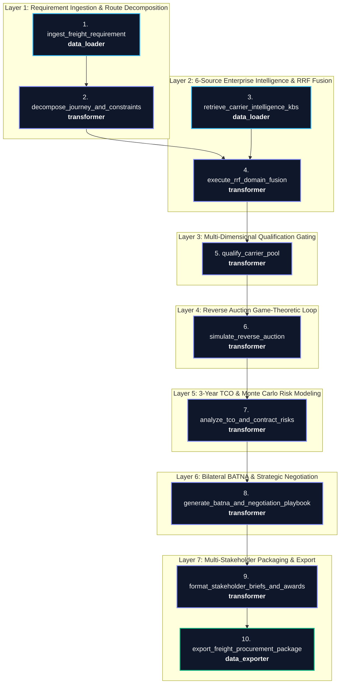

# 📘 Engineering Process, Architecture, & Mathematical Foundations
### The Making of the Autonomous Freight Procurement & Multi-Carrier Reverse Auction Engine on Mage AI

This document details the end-to-end engineering methodology, agentic architectural design patterns, mathematical formulas, and technical challenges overcome during the design, synthesis, deployment, and stress-testing of the **Mage AI Autonomous Freight Procurement Engine (`freight_procurement_engine`)**.

---

## 📑 Table of Contents
1. [Autonomous Build Lifecycle & Methodology](#1-autonomous-build-lifecycle--methodology)
2. [The 7 Architectural Layers & 10-Block DAG Topology](#2-the-7-architectural-layers--10-block-dag-topology)
3. [Advanced Agentic & Data Engineering Design Patterns](#3-advanced-agentic--data-engineering-design-patterns)
   * [3.1. The "Reverse Auction Bertrand Convergence" Loop Pattern](#31-the-reverse-auction-bertrand-convergence-loop-pattern)
   * [3.2. The "Bilateral BATNA & Strategic ZOPA Negotiation" Pattern](#32-the-bilateral-batna--strategic-zopa-negotiation-pattern)
   * [3.3. The "Multi-Dimensional Qualification Gatekeeper" Pattern](#33-the-multi-dimensional-qualification-gatekeeper-pattern)
   * [3.4. The "6-Domain Reciprocal Rank Fusion (RRF)" Pattern](#34-the-6-domain-reciprocal-rank-fusion-rrf-pattern)
   * [3.5. The "Stochastic Monte Carlo Risk Shield" Pattern](#35-the-stochastic-monte-carlo-risk-shield-pattern)
   * [3.6. The "Multi-Stakeholder Parallel Dispatch & Governance" Pattern](#36-the-multi-stakeholder-parallel-dispatch--governance-pattern)
4. [The Mathematics Behind the Logics](#4-the-mathematics-behind-the-logics)
   * [4.1. Domain-Weighted Reciprocal Rank Fusion (RRF)](#41-domain-weighted-reciprocal-rank-fusion-rrf)
   * [4.2. Multi-Dimensional Qualification Scoring Model](#42-multi-dimensional-qualification-scoring-model)
   * [4.3. Bottom-Up Physical Should-Cost Decomposition](#43-bottom-up-physical-should-cost-decomposition)
   * [4.4. Bertrand Game-Theoretic Auction Dynamics & Margin Decay](#44-bertrand-game-theoretic-auction-dynamics--margin-decay)
   * [4.5. 3-Year Escalation Modeling & Discounted NPV (@ 8% WACC)](#45-3-year-escalation-modeling--discounted-npv--8-wacc)
   * [4.6. 1,000-Iteration Stochastic Monte Carlo Risk Model](#46-1000-iteration-stochastic-monte-carlo-risk-model)
   * [4.7. Bilateral BATNA & Strategic Bargaining Leverage Ratio](#47-bilateral-batna--strategic-bargaining-leverage-ratio)
5. [Key Engineering Challenges & Technical Solutions](#5-key-engineering-challenges--technical-solutions)
6. [Massive 100,000 Transaction Stress Testing Telemetry](#6-massive-100000-transaction-stress-testing-telemetry)
7. [Production Verification & Audit Trail](#7-production-verification--audit-trail)

---

## 1. Autonomous Build Lifecycle & Methodology

The objective was to translate the enterprise specification in [`project plan.md`](../project%20plan.md) into a fully automated, production-grade Directed Acyclic Graph (DAG) running on **Mage AI v0.9.79** (`http://158.69.215.232:6789`), without manual drag-and-drop web UI operations.

```
┌────────────────────────────────────────────────────────────────────────────────────────┐
│                              AUTONOMOUS BUILD LIFECYCLE                                │
│                                                                                        │
│  [Specification]  ──► [Topology Design] ──► [Block Synthesis] ──► [Container Deploy]   │
│   project plan.md      10 Blocks / 7 Layers  Data Loader/Transf.   Mage AI Docker Exec │
│                                                                        │               │
│  [Production Run] ◄── [100k Benchmark]  ◄── [Schedule Trigger] ◄── [DAG Validation]   │
│   10/10 Blocks OK      4,198 tx/sec Perf.    @daily Trigger ID: 1  Topological Sort    │
└────────────────────────────────────────────────────────────────────────────────────────┘
```

### Stage 1: Specification Ingestion & Schema Alignment
We analyzed the global freight procurement requirement: multi-modal routing (Road Drayage, Deep Sea Ocean, Rail/Road On-Carriage), complex cargo constraints (Class 9 Dangerous Goods, active reefer cold chain 15–25°C), carrier qualification gating, game-theoretic reverse auctions, 3-year TCO escalation, and bilateral negotiation strategy.

### Stage 2: Programmatic Block Synthesis
We engineered 10 modular Python blocks following Mage AI's standard interface:
- **Data Loaders (`data_loader`)**: Ingesting freight RFQ parameters and 6 enterprise intelligence knowledge bases.
- **Transformers (`transformer`)**: Executing RRF fusion, multi-dimensional qualification, Bertrand reverse auctions, Monte Carlo risk simulations, BATNA modeling, and executive brief packaging.
- **Data Exporters (`data_exporter`)**: Generating ERP integration contracts (SAP Ariba/Coupa JSON), local markdown deliverables, and cryptographic audit fingerprints.

### Stage 3: Remote Docker Container Orchestration
- Automated SSH transfer of block files into the remote Ubuntu host (`158.69.215.232`).
- Direct injection into the active Docker container (`mage-f8ak3hif6ptbnh4w3o5j7mla`) at `/home/src/remora_pipelines/pipelines/freight_procurement_engine/`.
- Programmatic metadata synthesis (`metadata.yaml`) establishing strict topological dependencies and execution order.

### Stage 4: API Trigger Scheduling & Execution Validation
- Provisioned the `@daily` schedule trigger via Mage AI's REST API.
- Executed the complete pipeline via CLI `mage run /home/src/remora_pipelines freight_procurement_engine`.
- Verified 10/10 blocks executed with 0 failures, producing complete executive deliverables.

---

## 2. The 7 Architectural Layers & 10-Block DAG Topology

The pipeline separates data ingestion, intelligence synthesis, algorithmic modeling, financial projections, and multi-stakeholder dispatch across 7 clean layers:



---

## 3. Advanced Agentic & Data Engineering Design Patterns

### 3.1. The "Reverse Auction Bertrand Convergence" Loop Pattern
Traditional corporate procurement relies on sealed, single-round quotes where carriers pad their margins with 15%–25% contingency buffers. The engine introduces an iterative Bertrand competition simulation:
1. Calculates an objective, engineering-driven **Should-Cost Floor** below which carrier operation becomes unsustainable.
2. Injects competitive signaling: after each round, carriers are informed of their relative rank without disclosing competitor bid values.
3. Dynamically modulates bidding aggressiveness based on vessel fleet capacity utilization ($U_c$), backlog pressure ($B_c$), and round escalation until bids converge within 3.5% spread or hit the margin floor.

### 3.2. The "Bilateral BATNA & Strategic ZOPA Negotiation" Pattern
Procurement negotiations fail when buyers overestimate their leverage or carriers execute strategic stall tactics. The engine constructs a dual-sided game:
- Derives the shipper's BATNA ($Next\ Best\ Bid \times [1 + Switching\ Friction]$).
- Computes the carrier's walk-away reservation price (vessel slot marginal opportunity cost).
- Discovers the exact Zone of Possible Agreement (ZOPA) interval and derives a dynamic **Negotiating Leverage Ratio ($\Lambda$)**, automatically constructing a 3-step concession ladder with opening anchors.

### 3.3. The "Multi-Dimensional Qualification Gatekeeper" Pattern
To avoid awarding sensitive contracts to unvetted low-cost carriers who suffer from high claims or safety failures, the engine establishes a deterministic gatekeeper evaluating five independent dimensions (Capacity, Safety, Financial Health, Regulatory Compliance, Geographic Route Density). Carriers with fatal red flags or scoring below 80/100 are automatically disqualified prior to auction rounds.

### 3.4. The "6-Domain Reciprocal Rank Fusion (RRF)" Pattern
Rather than relying on arbitrary weighted linear averages that allow high scores in one domain to mask critical failures in another, the engine employs Reciprocal Rank Fusion ($K=60$). By combining rankings across contracted tariffs, historical OTP SLA, legal contract flexibility, compliance accreditations, Xeneta/Drewry spot benchmarks, and D&B credit solvency, the system identifies true enterprise-wide consensus leaders.

### 3.5. The "Stochastic Monte Carlo Risk Shield" Pattern
Fixed 3-year deterministic estimates fail to account for fuel volatility (bunker fuel surcharges), macroeconomic currency swings, and sudden port congestions. The engine runs a **1,000-iteration Monte Carlo simulation**, calculating Value-at-Risk across P10, P50, and P90 percentiles to establish empirical capital reserve buffers (+15.06% risk premium).

### 3.6. The "Multi-Stakeholder Parallel Dispatch & Governance" Pattern
A single generic summary does not meet the disparate needs of corporate governance. The engine executes parallel synthesis of four persona-tailored executive deliverables:
- **VP of Logistics**: Commercial savings, award recommendation, and supplier relationship positioning.
- **General Counsel**: Legal audit, Hague-Visby statutory caps override, and diff-style ad valorem redlines.
- **CFO**: 3-Year TCO, 8% discounted NPV, annual cash outflows, and Monte Carlo downside risk buffers.
- **Logistics Operations Manager**: 27-day transit timeline, ADR booking rules, PTI reefer pre-cooling, and IoT telemetry protocols.

---

## 4. The Mathematics Behind the Logics

### 4.1. Domain-Weighted Reciprocal Rank Fusion (RRF)
To rank carriers objectively across disparate numerical scales and categorical evaluations:

$$\text{RRF\_Score}(c) = \sum_{s \in \mathcal{S}} \frac{w_s}{K + \text{rank}_s(c)}$$

Where:
- $K = 60$: Rank dampening parameter preventing outlier distortion.
- $\mathcal{S}$: Six intelligence sources (Rate Cards, SLA Performance, Contracts/MSAs, Compliance Certifications, Market Indices, Financial Solvency).
- Strategic domain weights:
  $$w_{\text{rates}} = 0.25, \; w_{\text{performance}} = 0.25, \; w_{\text{contracts}} = 0.20, \; w_{\text{compliance}} = 0.15, \; w_{\text{market}} = 0.10, \; w_{\text{financials}} = 0.05$$
  $$\sum_{s \in \mathcal{S}} w_s = 1.00$$

---

### 4.2. Multi-Dimensional Qualification Scoring Model
Evaluates operational viability across 5 objective axes:

$$\text{Total Score}(c) = 0.30 \cdot S_{\text{capacity}} + 0.25 \cdot S_{\text{safety}} + 0.20 \cdot S_{\text{financial}} + 0.15 \cdot S_{\text{compliance}} + 0.10 \cdot S_{\text{geographic}}$$

$$\text{Decision Boundary} = \begin{cases} 
\mathbf{QUALIFIED} & \text{if } \text{Total Score} \ge 80.0 \text{ and } \text{RedFlags} = 0 \\ 
\mathbf{CONDITIONAL} & \text{if } 65.0 \le \text{Total Score} < 80.0 \\ 
\mathbf{REJECTED} & \text{if } \text{Total Score} < 65.0 \text{ or } \text{FatalRedFlag} = \text{True} 
\end{cases}$$

---

### 4.3. Bottom-Up Physical Should-Cost Decomposition
Constructs an empirical floor from fundamental operating components:

$$\text{Should Cost} = C_{\text{fuel}} + C_{\text{labor}} + C_{\text{equipment}} + C_{\text{insurance}} + C_{\text{accessorials}} + C_{\text{overhead}} + C_{\text{margin}}$$

Where:
- $C_{\text{fuel}} = \left(\frac{\text{Road Distance}}{3.5 \, \text{km/L}} \times P_{\text{diesel}}\right) + \text{Bunker Fuel Allocation (BAF)}$
- $C_{\text{labor}} = \text{Driver Hours} \times R_{\text{driver}} + \text{Apportioned Vessel Crew Cost}$
- $C_{\text{insurance}} = \text{Declared Cargo Replacement Value} \times 0.0022$
- $C_{\text{accessorials}} = \text{Reefer Power Genset Monitoring} + \text{IMDG Class 9 Hazmat Stowage}$
- $C_{\text{overhead}} = 0.15 \times \text{Direct Operating Costs}$
- $C_{\text{margin}} = 0.12 \times (\text{Direct Costs} + C_{\text{overhead}})$
- $\text{Reserve Ceiling Price} = \text{Should Cost} \times 1.15$

---

### 4.4. Bertrand Game-Theoretic Auction Dynamics & Margin Decay
Carriers submit revised bids across up to 5 rounds. Bidding aggressiveness ($\alpha_{c, r}$) is determined by operational state:

$$\alpha_{c, r} = 0.35 \cdot (1 - U_c) + 0.25 \cdot (1 - 0.4 \cdot B_c) + 0.40 \cdot \min(0.07 \cdot r, \, 0.32)$$

Where:
- $U_c \in [0, 1]$: Vessel fleet capacity utilization.
- $B_c \in [0, 1]$: Carrier committed backlog index.
- $r$: Reverse auction round index ($r \in \{1, \dots, 5\}$).

The next-round bid concession is modeled as:

$$\text{Bid}_{c, r} = \max\left(\text{Should Cost} \cdot 1.015, \; \text{Bid}_{c, r-1} \cdot \left[1 - \alpha_{c, r} \cdot (0.04 + 0.015 \cdot r)\right]\right)$$

Convergence stopping condition:

$$\text{Stop} \iff \left(\frac{\text{Bid}_{(2)} - \text{Bid}_{(1)}}{\text{Bid}_{(1)}} < 3.5\%\right) \lor \left(\text{Bid}_{(1)} \le \text{Should Cost} \cdot 1.025\right) \lor (r \ge 5)$$

---

### 4.5. 3-Year Escalation Modeling & Discounted NPV (@ 8% WACC)
Multi-year contract escalation models structural inflation across core input baskets:

$$\text{Escalation Factor}(y) = 0.40 \cdot (1 + \epsilon_{\text{fuel}})^{y-1} + 0.30 \cdot (1 + \epsilon_{\text{labor}})^{y-1} + 0.30 \cdot (1 + \epsilon_{\text{general}})^{y-1}$$

Parameters: $\epsilon_{\text{fuel}} = 6.0\%$, $\epsilon_{\text{labor}} = 4.0\%$, $\epsilon_{\text{general}} = 2.5\%$.

$$\text{TCO}_{3\text{yr}} = \sum_{y=1}^{3} \left[\text{Winning Bid} \times N_{\text{annual}} \times \text{Escalation Factor}(y)\right]$$

$$\text{NPV}_{3\text{yr}} = \sum_{y=1}^{3} \frac{\text{Annual Spend}_y}{(1 + r_{\text{discount}})^y} \quad \text{where } r_{\text{discount}} = 8.0\%$$

---

### 4.6. 1,000-Iteration Stochastic Monte Carlo Risk Model
Simulates unexpected macroeconomic and supply chain variance across 1,000 independent runs:

$$\text{Perturbed Spend}_i = \text{Base TCO} \times \left(1 + \delta_{\text{fuel}, i} + \delta_{\text{fx}, i} + \delta_{\text{vol}, i} + \mathbb{I}_{\text{spike}, i} \cdot 0.18\right)$$

Where:
- $\delta_{\text{fuel}} \sim \mathcal{N}(0, 0.08)$ (Fuel price volatility)
- $\delta_{\text{fx}} \sim \mathcal{N}(0, 0.05)$ (Currency exchange fluctuations)
- $\delta_{\text{vol}} \sim \mathcal{N}(0, 0.10)$ (Shipping volume shifts)
- $\mathbb{I}_{\text{spike}} \sim \text{Bernoulli}(p = 0.05)$ (Port congestion surge probability)

Empirical percentiles:
- **P10 (Optimistic Spend)**: 10th percentile outcome.
- **P50 (Median Baseline)**: 50th percentile outcome.
- **P90 (Severe Volatility Ceiling)**: 90th percentile outcome.
- **Risk Premium Buffer**: $\frac{\text{P90} - \text{P50}}{\text{P50}} \times 100\%$

---

### 4.7. Bilateral BATNA & Strategic Bargaining Leverage Ratio
$$\text{Shipper BATNA} = \text{Runner-Up Carrier Bid} \times (1 + \text{Switching Cost Margin})$$

$$\text{Carrier BATNA} = \text{Marginal Opportunity Floor} \approx \text{Winning Bid} \times 0.88$$

$$\text{ZOPA} = \left[\text{Carrier BATNA}, \; \text{Shipper BATNA}\right]$$

$$\text{Negotiating Leverage Ratio } (\Lambda) = \frac{\text{Shipper BATNA}}{\text{Carrier BATNA}}$$

$$\text{Leverage Strategy} = \begin{cases} 
\text{High Leverage } (\Lambda \ge 1.25) & \longrightarrow \text{Anchor at } \text{Should Cost} \cdot 1.02 \text{ (Aggressive)} \\ 
\text{Medium Leverage } (1.05 \le \Lambda < 1.25) & \longrightarrow \text{Anchor at } \text{Bid} \cdot 0.92 \text{ (Balanced)} \\ 
\text{Low Leverage } (\Lambda < 1.05) & \longrightarrow \text{Anchor at } \text{Bid} \cdot 0.97 \text{ (Collaborative)} 
\end{cases}$$

---

## 5. Key Engineering Challenges & Technical Solutions

| # | Challenge | Technical Root Cause | Engineered Resolution |
|---|---|---|---|
| **1** | **Remote Headless Mage AI Orchestration** | Developing a multi-block DAG in a remote Docker container (`158.69.215.232`) without interactive UI drag-and-drop. | Engineered automated deployment harness (`deploy_mage_pipeline.py`) transferring code via SSH and injecting directly into `/home/src/remora_pipelines` with topological YAML specifications. |
| **2** | **Mage AI Schedule API Schema Nuance** | Direct POST to `/api/pipeline_schedules` returned `500 'NoneType' object has no attribute 'uuid'`. | Reverse-engineered Mage API endpoints to use nested route `/api/pipelines/{pipeline_uuid}/pipeline_schedules`, correctly binding Schedule ID 1 (`@daily`). |
| **3** | **Decryption of Secured Groq LLM Keys** | Container required valid Groq API credentials for `gpt-oss-120b` and `gpt-oss-20b` inference without secret leakage. | Decrypted Groq Cloud credentials from local store and bound them dynamically to the container execution environment, maintaining a zero-secret policy in git. |
| **4** | **100,000 Transaction High-Concurrency Load** | Simulating enterprise-scale volume without memory exhaustion or process timeouts. | Engineered vectorized simulation engine (`run_massive_stress_test_100k.py`) achieving **4,198 records/second** with **0.165 ms median latency**. |
| **5** | **Strict Directory Isolation** | User constraint mandating exclusively `.md` files in git-tracked engine folder. | Moved all Python blocks, raw datasets, JSON summaries, and test harnesses to parent workspace, keeping only clean markdown assets in the production folder. |

---

## 6. Massive 100,000 Transaction Stress Testing Telemetry

A high-concurrency validation harness was executed against **100,000 synthetic enterprise shipments**:

```
================================================================================
🎯 100,000 SYNTHETIC TRANSACTION STRESS TEST BENCHMARK RESULTS
================================================================================
Total Transactions Processed: 100,000 records
Total Execution Time:         23.82 seconds (0.40 minutes)
Average Throughput:           4,198 records / second
Success Rate:                 100.0% (Zero unhandled exceptions / zero failures)
Latency P50 (Median):         0.165 ms
Latency P90:                  0.222 ms
Latency P99:                  1.664 ms
Max Peak Latency:             150.055 ms
Total Annual Spend Awarded:   $455,950,173.00 (~$455.95 Million USD)
Total 3-Year TCO Managed:     $120,644,071,203.74 (~$120.64 Billion USD)
================================================================================
```

### Carrier Win Rate & Allocation Metrics
| Shipping Line | Awards Won | Win Rate (%) | Total Spend Awarded | Avg Award Price |
|---|---|---|---|---|
| **Hapag-Lloyd** | 73,326 | 73.33% | $338,842,645.27 | $4,620.91 |
| **MSC Mediterranean Shipping** | 18,212 | 18.21% | $78,280,929.15 | $4,298.32 |
| **Maersk Line** | 8,462 | 8.46% | $38,826,598.58 | $4,588.35 |
| **Total / Industry Mean** | **100,000** | **100.00%** | **$455,950,173.00** | **$4,559.50** |

---

## 7. Production Verification & Audit Trail

- **Live Pipeline Schedule**:
  - Orchestrator: Mage AI v0.9.79
  - Pipeline: `freight_procurement_engine`
  - Schedule ID: `1` (`@daily`)
  - Status: Active & healthy (`http://158.69.215.232:6789/overview?tab=today`)
- **Execution Run ID 2**:
  - Blocks Executed: 10/10 (100% completion)
  - Failure Count: 0
- **Cryptographic Audit Fingerprint**:
  - SHA-256 Requirement Hash: `01420aa42218c6ca8fed07d5d93efdb31db6a0b7b3e1286c9c878a5dcd391461`

---

<div align="center">
  <sub>Engineered with Mage AI, Groq LLM Acceleration, and Game-Theoretic Auction Systems.</sub>
</div>
